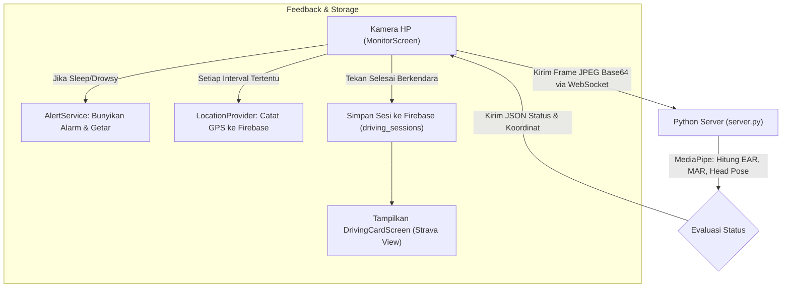

# 🚗 DOKUMENTASI ARSITEKTUR & RINGKASAN KODE DRIVING BUDDY

Dokumentasi ini dibuat sebagai referensi cepat arsitektur, flow data, konfigurasi, dan fungsi tiap modul/file. Gunakan file ini sebagai acuan analisis agar tidak perlu membaca ulang seluruh codebase baris-per-baris.

---

## 📌 1. Ikhtisar Sistem (High-Level Overview)

* **Platform Frontend:** Flutter (Android, iOS, Web).
* **Backend AI Server:** Python FastAPI (`server.py`) dengan MediaPipe Face Mesh & OpenCV. Komunikasi via WebSocket (`ws://<IP>:8000/ws`).
* **Database & Auth:** Firebase (Google Cloud Firestore + Firebase Authentication + Firebase Storage).
* **Rute & Tempat Terdekat:** OpenStreetMap (Overpass API) untuk pencarian pitstop (rest area, SPBU, masjid, minimarket, kafe).
* **Tujuan Aplikasi:** Mendeteksi kantuk, menguap, dan microsleep secara real-time saat berkendara, memberikan alarm audio/visual, merekam sesi perjalanan ke cloud, serta menampilkan ringkasan performa bergaya Strava.

---

## 🗂️ 2. Struktur Folder & Peran Tiap File

### A. Root & Konfigurasi
* `lib/main.dart`
  * Entry point aplikasi Flutter (`void main()`). Inisialisasi Firebase dan pengaturan preferensi orientasi layar (portrait).
  * Menjalankan `MaterialApp` dengan routing terpusat dari `AppRoutes`.
* `lib/routes/app_routes.dart`
  * Definisi named routes (`/login`, `/main`, `/home`, `/monitor`, `/history`, `/settings`, `/driving-card`).
  * `onGenerateRoute`: Parsing argumen untuk navigasi dinamis ke `DrivingCardScreen`.
* `lib/supabase_service.dart`
  * Meng-export `supabase_config.dart`.
  * `AuthService`: Register, login, logout, cek sesi user, ambil nama user dari tabel `profiles`.
  * `SessionService`: `startSession()`, `endSession()`, `addGpsPoint()`, `logEvent()`, `getUserSessions()`, `getGpsTracks()`.
* `lib/supabase_config.dart` *(di-ignore oleh git)*
  * Berisi konstanta `supabaseUrl` dan `supabaseAnonKey`.
* `lib/supabase_config.example.dart`
  * Template konfigurasi publik untuk repository.

---

### B. Core & Models
* `lib/core/app_colors.dart`
  * Palet warna utama: `primary` (#E57A38), `primaryDark`, `background` (#0A0F1D / #0F172A), `surface`, `accent`, `danger`, `success`, `warning`.
* `lib/core/thresholds.dart`
  * Ambang batas deteksi: EAR (Eye Aspect Ratio), MAR (Mouth Aspect Ratio), durasi kantuk, durasi microsleep, pitch kepala.
* `lib/models/trip_model.dart`
  * Model data perjalanan: `TripRecord`, `RestAreaRecommendation`, `WeeklySummary`.
* `lib/models/account_config.dart`
  * Model akun pengemudi, preferensi notifikasi, dan pengaturan profil.
* `lib/models/detection_result.dart`
  * Data class hasil inferensi frame dari server: status (`Awake`, `Drowsy`, `Sleep`, `Yawn`, `No Face`), nilai EAR, MAR, blinkCount, yawnCount, dan koordinat mesh.

---

### C. Screens & Views
* `lib/screens/main_shell.dart`
  * Container utama dengan bottom navigation bar modern.
  * Menampung 3 tab utama: Index 0 (`HomeScreen`), Index 1 (`MonitorScreen`), Index 2 (`HistoryScreen`).
* `lib/screens/home_screen.dart` (Dashboard / Cockpit)
  * Menampilkan salam pengemudi, status server backend (indikator koneksi), tombol aksi cepat "Mulai Berkendara", cuaca ringkas, dan mini-card pitstop terdekat.
* `lib/screens/monitor_screen.dart` (Layar Monitoring Real-time)
  * Mengontrol kamera depan via controller `camera`.
  * Mengirim frame base64 via WebSocket ke `server.py` dan menerima respons JSON deteksi.
  * Menampilkan overlay mesh mata/mulut, status kewaspadaan, durasi berkendara, dan kecepatan.
  * Membunyikan alarm jika status `Sleep` atau `Drowsy` berulang.
  * Saat sesi diakhiri, menyimpan data ke Firebase dan memunculkan pop-up ajakan melihat `DrivingCardScreen`.
* `lib/screens/history_screen.dart` (Riwayat Perjalanan)
  * Mengambil histori sesi dari Firebase (`SessionService.getUserSessions()`).
  * Menampilkan daftar kartu sesi (tanggal, durasi, total event kantuk, skor berkendara).
  * Terdapat tombol "Lihat Kartu Berkendara" di setiap kartu untuk membuka tampilan Strava.
* `lib/screens/settings_screen.dart` (Pengaturan Akun & Alarm)
  * Pengaturan IP server backend (disimpan ke `SharedPreferences`).
  * Pilihan suara alarm (alarm, beep, buzzer) dan mode gambar bahaya (standar / kustom).
  * Tombol logout akun.
* `lib/auth_screen.dart`
  * Halaman Login & Registrasi dengan tab controller, field email/password/nama, dan integrasi `AuthService`.
* `lib/driving_card_screen.dart` (Strava-like Driving Card)
  * Kartu visual mewah ringkasan perjalanan: Skor keselamatan (animated score ring), jarak, durasi, kecepatan rata-rata, grafik rute, dan badge achievement otomatis (`#PengemudiHandal`, `#ZeroMicrosleep`, `#MarathonDriver`, dll).
  * Tombol Share untuk export/berbagi hasil performa.

---

### D. Fitur Tempat Terdekat (`lib/features/nearby_places/`)
* `data/direct_osm_places_api.dart`: Query langsung ke Overpass API OpenStreetMap untuk mengambil node POI sekitar koordinat user (radius 5-15 km).
* `data/location_provider.dart`: Wrapper `geolocator` untuk mendapatkan koordinat GPS latitude/longitude terkini pengemudi.
* `data/places_api.dart` & `data/places_config.dart`: Abstraksi API dan konfigurasi kategori tempat.
* `logic/nearby_controller.dart`: State controller untuk caching, filtering kategori (SPBU, Rest Area, Masjid, Makanan), dan sorting berdasarkan jarak terdekat.
* `logic/geo_math.dart`: Rumus Haversine untuk kalkulasi jarak (km) antar dua koordinat GPS.
* `logic/place_launcher.dart`: Membuka koordinat tujuan langsung di aplikasi Google Maps / Waze (`url_launcher`).
* `ui/nearby_sheet.dart`: Modal bottom sheet interaktif daftar rekomendasi tempat.
* `ui/pitstop_card.dart`: Widget kartu pitstop yang muncul di dashboard.

---

### E. Services & Audio
* `lib/services/alert_service.dart`: Pengontrol pemutaran audio alarm (`audioplayers`) dan haptic feedback (getaran HP).
* `lib/services/alert_config.dart`: Model konfigurasi tipe suara dan toleransi peringatan.
* `lib/services/camera_image_converter.dart`: Utility konversi format frame kamera (`CameraImage`) ke bytes/base64 untuk pengiriman WebSocket.
* `lib/services/drowsiness_detector.dart`: Logika filter dan smoothing hasil deteksi.
* `lib/widgets/driving_buddy_app_bar.dart`: AppBar kustom konsisten dengan status koneksi dan tombol profil/pengaturan.

---

### F. Backend Python (`server.py`)
* **Framework:** FastAPI + WebSockets + Uvicorn.
* **Engine AI:** MediaPipe Face Mesh (468 facial landmarks).
* **Algoritma:**
  1. **EAR (Eye Aspect Ratio):** Menghitung rasio vertikal terhadap horizontal kelopak mata kiri & kanan.
     * Jika EAR < 0.21 selama $\ge$ 1.5 detik $\rightarrow$ **Status `Sleep` / Microsleep**.
  2. **MAR (Mouth Aspect Ratio):** Menghitung rasio keterbukaan bibir luar.
     * Jika MAR > 0.35 selama $\ge$ 1.2 detik $\rightarrow$ **Status `Yawn`**.
  3. **Head Pose Estimation:** Rasio hidung terhadap batas wajah untuk mendeteksi kepala menunduk $\ge$ 2.0 detik $\rightarrow$ **Status `Drowsy`**.
* **Payload WebSocket:** Mengembalikan JSON `{status, subStatus, ear, mar, blinkCount, yawnCount, eyePoints, mouthPoints}`.

---

## 🔄 3. Alur Data Utama (Data Flow Lifecycle)

---

## 🔑 4. Panduan Cepat untuk Modifikasi / Debugging

| Kebutuhan Anda | File yang Perlu Diedit |
|---|---|
| **Ubah sensitivitas kantuk/kedipan** | `server.py` (threshold EAR/MAR) & `lib/core/thresholds.dart` |
| **Ganti tampilan kartu hasil akhir (Strava)** | `lib/driving_card_screen.dart` |
| **Ubah warna / tema global** | `lib/core/app_colors.dart` |
| **Ubah tampilan layar kamera & HUD** | `lib/screens/monitor_screen.dart` |
| **Ubah logika rekomendasi pitstop / SPBU** | `lib/features/nearby_places/logic/nearby_controller.dart` |
| **Ubah skema database / auth** | `lib/supabase_service.dart` & `lib/supabase_config.dart` |
| **Ubah navigasi atau tambah halaman baru** | `lib/routes/app_routes.dart` |

